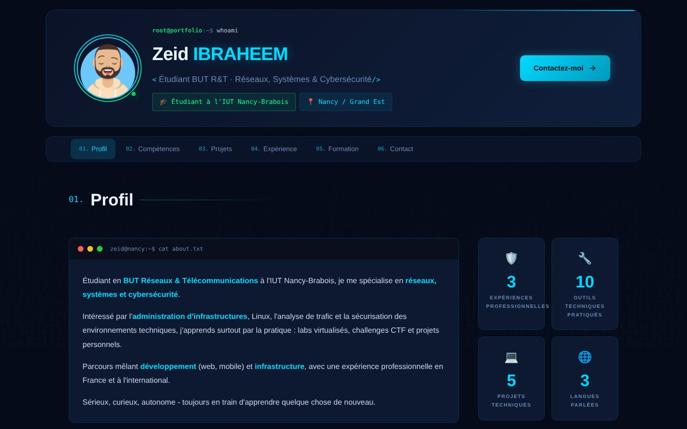
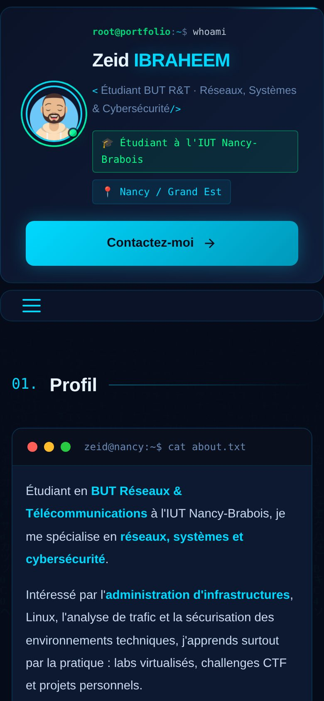

# Portfolio R&T

Mon portfolio de BUT Réseaux & Télécommunications : profil, compétences, projets, expériences, formation, et un formulaire pour me contacter.

**Je cherche un stage de 10 semaines, du 12 avril au 18 juin 2027 : réseaux, systèmes, sécurité ou informatique.**

**Voir le site : https://zeid-ibraheem.github.io/portfolio-rt/**

  

  

<!-- À TOI : à quoi il te sert (le portfolio demandé par le BUT, tes candidatures de stage…). Ta dictée remplacera ce paragraphe. -->
Je voulais un endroit unique où montrer ce que je fais, au-delà d'un CV d'une page : les projets en détail, les outils que j'utilise et mon parcours. Le style terminal, c'est un clin d'œil à ce que je fais au quotidien sous Linux.

## Technique

HTML, CSS et JavaScript, sans framework, hébergé par GitHub Pages.
